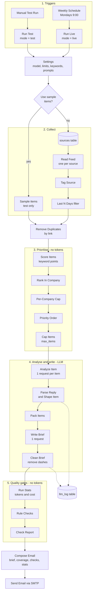

# AI Release Tracker (no-code, n8n)

A free, self-hosted n8n workflow that watches OpenAI, Anthropic and Google, and writes a weekly brief on **what changed and why it matters to product managers**. Every item carries a category tag, a PM lens, an urgency and a source link.

Built as a hands-on project to practise AI product management: scoping, prioritising under a quota, human review, and checking an LLM's output without spending money.

## The problem

AI vendors ship pricing changes, deprecations, new models and policy updates every week, spread across blogs and changelogs. A PM building on these models needs to know which changes affect roadmap, cost or risk, and which are noise.

Newsletters summarise the news. This workflow answers a narrower question: **what should a PM do about it?**

## What it does

→ Reads RSS feeds from a `sources` table (add a product by adding a row)
→ Keeps the last 7 days, removes duplicates, and scores items by keyword before spending any tokens
→ Caps items per company so one busy feed cannot crowd out the others
→ Sends each selected item to an LLM for tags, a summary and a suggested PM action
→ Writes a short brief of the top 5 items, in plain language
→ Runs 10 rule checks on the output, then emails a draft for human review

Nothing is posted automatically. The output is a draft that a person reads first.

## Architecture



Full node list, data tables and settings: [docs/architecture.md](docs/architecture.md)

## Example run

Real output from a test run on live feeds, shortened for display. The coverage section tells the reader what was left out, and why.

```text
=== COVERAGE ===
Fetched after date filter and duplicates: 45
Analysed: 25
Not analysed: 20
Top 10 not-analysed items by priority score:
- [OpenAI] More ways to move care forward with ChatGPT for Healthcare (score 2, cut by per-company cap)
- [OpenAI] At Holiday Extras, dots get to work before anyone asks (score 1, cut by per-company cap)
- [OpenAI] Strengthening NATO and allied cyber defenses with AI (score 0, cut by per-company cap)
- (7 more items not shown here)

=== RULE CHECKS (9 of 9 passed) ===
PASS    Brief under 3000 characters
PASS    No em-dashes or en-dashes
PASS    No hashtags
PASS    Every link in the brief is a real fetched link
PASS    Brief covers 5 items or fewer
PASS    All tags use allowed values
PASS    Every item has summary, so-what and action
PASS    No duplicate items
PASS    Every selected item was analysed
PASS    Numbers in the brief appear in the source text (can false-alarm, check by eye)
```

<!-- TODO: add a screenshot of the workflow canvas at docs/images/workflow.png and a sample brief -->

## Design decisions

| Decision | Why |
|---|---|
| **Three tags plus impact** (category, PM lens, urgency, impact) | A summary is not a decision. The PM lens (Build, Cost, Risk, Compete, Users) says why the change matters. Urgency says when to act. |
| **Prioritise before spending tokens** | The first version kept the 15 newest items, which let minor posts push out an older pricing change. Keyword scoring, a per-company cap and a visible coverage report fixed this. |
| **Requests, not tokens, are the scarce resource** | On a free LLM tier, daily request limits bite long before token limits do. One request per item plus one for the brief keeps the cost predictable. |
| **A human reviews every draft** | The brief arrives by email as a draft. There is no auto-posting. |
| **Links come from the data, never from the model** | A rule check confirms every link in the brief was actually fetched. |
| **One provider setting** | The LLM call uses an OpenAI-compatible endpoint. Switching model or provider is two Settings fields and one credential. |
| **A plain HTTP request, not an AI agent node** | Each step is one prompt in and one JSON out. That makes it cheaper (often free), faster and more deterministic. No memory and no tool calling are needed. |
| **Free first** | n8n Community Edition (self-hosted), Gemini free tier, Gmail SMTP. Total cost is zero. |

## How output quality is checked

Ten deterministic checks run on every execution and add no LLM cost. They cover length, banned characters, link integrity, item count, allowed tag values, completeness, duplicates, and whether every selected item was analysed. A tenth, soft check flags numbers in the brief that are missing from the source text.

What these checks **do not** cover: whether the tags are *correct*. A brief can pass every check and still label a pricing change as a new feature. Measuring accuracy needs a hand-labelled golden set, which is the first item under next steps.

The checks themselves needed tuning. The first version flagged real links as fake when the model wrapped them in markdown bold or added a trailing slash.

## Cost and limits

- **LLM requests per run = items analysed + 1.** With `max_items = 25`, a full run is about 26 requests. Retries can add more.
- Token usage is logged per call in the `llm_log` table and summarised in each email. In testing, the API's total tokens matched prompt plus completion tokens.
- Free-tier quotas are set per project and change over time. Check your own limits in Google AI Studio before raising `max_items`.
- On the free tier, Google may use prompts to improve its models. All inputs here are public content.
- The machine running Docker must be on at the scheduled time. A quiet week with no new items sends no email.

## Known gaps and next steps

- **Golden-set evaluation.** Hand-label about 30 real items and measure tag accuracy and which categories get confused.
- **API changelog pages are not covered.** Pricing changes and deprecations often appear only there, and they have no feed. This is the biggest gap for PM value.
- **Keyword scoring is a heuristic.** It is transparent and free, but it will miss unusual wording. The coverage report shows what was dropped, so the keyword list can be tuned.
- **Community-generated feeds can break.** The Anthropic and Google Developers feeds are third-party. Disable one by setting `enabled` to false in `sources`.
- **Batching or title-only triage** would cover more items per request.

## Repo contents

```text
workflows/   Three n8n workflow exports (tracker, one-time setup, error alert)
prompts/     The two prompts, as text
docs/        Architecture and setup guide
```

## Quick start

1. Run n8n with Docker.
2. Import `workflows/AI_Release_Tracker_-_one-time_setup.json` and run it once.
3. Import the tracker and error alert workflows, then attach your credentials.
4. Run a test with sample items.

Step by step: [docs/setup.md](docs/setup.md)

## Tech stack

n8n Community Edition (self-hosted, Docker), n8n Data tables, Google Gemini API (OpenAI-compatible endpoint, free tier), Gmail SMTP.

The Anthropic and Google Developers feeds come from the open-source [rss-feeds](https://github.com/Olshansk/rss-feeds) project by Olshansk. The OpenAI and Google DeepMind feeds are official.

<!-- TODO: add a LICENSE file (MIT is a common choice) and a license line here -->
