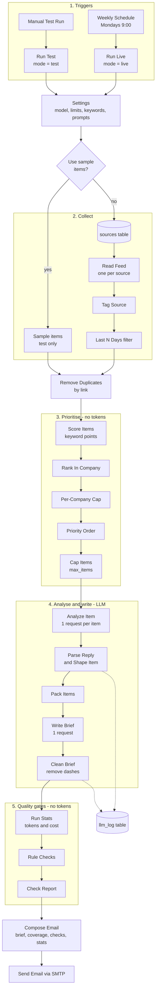
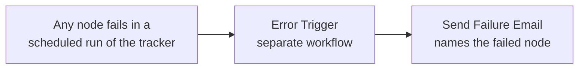

# Architecture

The project is three n8n workflows. Only the first runs every week.

| Workflow | Purpose |
|---|---|
| **AI Release Tracker** | The weekly pipeline, triggered by a schedule or a manual test run |
| **one-time setup** | Creates the two data tables and adds 5 starter feeds. Run once. |
| **error alert** | A separate workflow that emails you when a scheduled run fails |

## Tracker pipeline

## Error alert workflow

n8n only fires error workflows for automatic (scheduled) runs, not for manual runs. A failed manual run shows its error on screen instead.

## Nodes by stage

| Stage | Node | What it does | LLM tokens |
|---|---|---|---|
| Trigger | Weekly Schedule, Manual Test Run | Live run on Mondays, or a manual test | none |
| Config | Settings | One place for model, limits, keywords and prompts | none |
| Collect | Load Sources, Read Feed, Tag Source | Read each enabled feed, tag items with company and source | none |
| Collect | Last N Days | 7 days live, 30 days in test | none |
| Collect | Sample Items | 11 synthetic items with expected labels, for free testing | none |
| Prioritise | Remove Duplicates | Drops repeated links | none |
| Prioritise | Score Items, Rank In Company, Per-Company Cap | Keyword score, rank inside each company, keep the top N per company | none |
| Prioritise | Priority Order, Cap Items | Sort by priority, keep `max_items` | none |
| Analyse | Analyze Item | One LLM request per item, returns tags and a PM action as JSON | yes |
| Analyse | Parse Reply, Shape Item | Parse the JSON, attach links from the fetched data | none |
| Brief | Pack Items, Write Brief | One LLM request writes the top-5 brief | yes |
| Brief | Clean Brief | Replaces any em or en dash, counts characters | none |
| Log | Item Log Row, Log Item, Brief Log Row, Log Brief | One row per call in `llm_log` | none |
| Quality | Run Stats, Prep Checks, Rule Checks, Check Report | Totals, then the deterministic checks | none |
| Deliver | Compose Email, Send Email | Draft, coverage, checks and stats in one email | none |

## Prioritisation

For each item, the **score** is:

- +3 for every boost keyword found at the start of a word in the title
- +1 for every boost keyword found in the body text
- -5 for every demote keyword found in the title
- limited to the range 0 to 30

**Priority** is the score, with the date as a tie-breaker. Within each company, items are ranked by priority and only the top `per_company_cap` continue. The remainder are sorted by priority and cut at `max_items`.

Keywords are stored as comma-separated text in Settings and matched at the start of a word, so `deprecat` matches deprecated and deprecation. Avoid brackets, dots, plus signs and stars in keywords.

## Data tables

**sources**: `company`, `name`, `url`, `enabled`

**llm_log**: one row per LLM call.

| Column | Meaning |
|---|---|
| run_id, mode | Run identifier, and `live` or `test` |
| step | `item` or `brief` |
| model | Model used |
| company, title, link | The item (blank for the brief row) |
| category, pm_lens, urgency, impact, so_what | The LLM's tags and reasoning |
| prompt_tokens, completion_tokens, est_cost_usd | Usage and estimated cost |

## Settings reference

| Field | Default | Meaning |
|---|---|---|
| test_source | `samples` | In test mode, use `samples` (no feeds fetched) or real `feeds` |
| lookback_days_live, lookback_days_test | 7, 30 | How far back to look |
| max_items | 25 | Items sent to the LLM. A full run is `max_items + 1` requests. |
| per_company_cap | 10 | Maximum items kept per company before the overall cap |
| llm_base_url, llm_model | Gemini OpenAI-compatible endpoint, a Flash-Lite model | Check which models your key can use |
| request_gap_ms | 7000 | Pause between item calls to respect per-minute limits |
| price_in_per_1m, price_out_per_1m | 0 | Set these when using a paid model, so cost estimates are real |
| token_limit_per_run | 60000 | Adds a warning to the email subject when exceeded |
| email_from, email_to | placeholders | Your address |
| boost_keywords, demote_keywords | see workflow | Raise or lower an item's priority |
| prompt_item, prompt_brief | see [prompts](../prompts) | The two LLM instructions |

## Design notes

- **OpenAI-compatible endpoint.** Gemini, Ollama and other providers accept the same request format, so one HTTP request shape serves any of them.
- **No agent node.** The LLM steps are plain HTTP requests. The work needs no memory and no tool calling, so a single prompt per item is cheaper, faster and more predictable than an agent.
- **The model never supplies links.** Links are copied from the fetched data into the item record, and the brief step is only allowed to reuse them. A rule check enforces this.
- **Test and live share one log table.** They are separated by the `mode` column.
- **Failure behaviour.** An LLM node retries up to three times. If it still fails, the run stops and the error alert fires.
